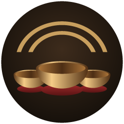

# Singing Bowls Concert 1.1

Give your own singing bowl concert. Pick up to 8 of 14 bowls, put them side by side and play them all at once: strike them, stir them with several fingers, or let them sing together. Every sound is synthesized live with the Web Audio API, so there are no audio files and the app needs no internet.

## Concert mode

1. Choose up to 8 bowls from the list below the stage. They line up from low to high and are numbered 1–8.
2. Play them:
   - **Tap a bowl** to strike it. Tap near the rim for a brighter tone.
   - **Draw circles around a bowl** to stir it and make it sing. About one round per second makes it sing fully.
   - **On a touch screen, use several fingers**: every finger plays its own bowl, so you can stir two bowls while tapping a third.

| Key | Action |
|-----|--------|
| `1`–`8` | Strike that bowl |
| `Shift` + `1`–`8` | Let that bowl sing, or stop it |
| `Space` | Strike all bowls at once |
| `W` | Let all bowls sing together (press again to stop) |
| `S` | Silence |
| `C` | Switch between concert and single-bowl mode |

## Single-bowl mode

Press `C` to look at one bowl at a time. Browse with `<` `>` or the arrow keys, or type its number (two digits quickly for 10–14).

## Bowls

| # | Bowl | Note | Theme |
|---|------|------|-------|
| 1 | Jambati bowl (the giant) | G2 | Earth |
| 2 | Large Tibetan bowl | C3 | Root |
| 3 | Om bowl (136.1 Hz) | C♯3 | Om |
| 4–9 | Tibetan bowls | D3 – B3 | Sacral, Solar plexus, Heart, Throat, Third eye, Crown |
| 10 | Mani bowl (small, Nepalese) | A4 | Clarity |
| 11 | Crystal bowl | C4 | Quartz |
| 12 | Rose quartz bowl | A3 (A = 432 Hz) | 432 Hz |
| 13 | Japanese keisu | F♯3 | Zen |
| 14 | Japanese rin | E5 | Temple bell |

## Languages

English (default) and Dutch, plus German, French and Spanish. Pick another language in the menu at the top right.

## Install (Windows)

1. Download the latest release zip and unzip it.
2. Double-click `launch.vbs`. The app opens in its own Microsoft Edge window.

You can also open `index.html` in any modern browser, including on a tablet.

## Support

If you enjoy the concert, you can [buy me a coffee ☕](https://urbantechmonk.gumroad.com/coffee).

---

## Nederlands

Geef je eigen klankschalenconcert. Kies tot 8 van de 14 schalen en bespeel ze tegelijk. Je kunt ze aanslaan, er met meerdere vingers in rondjes omheen roeren, of ze samen laten zingen. Cijfer 1–8 slaat een schaal aan, Shift + cijfer laat hem zingen, spatie slaat alles aan en W laat alles zingen. Met C wissel je naar één schaal tegelijk. Start de app door te dubbelklikken op `launch.vbs`.

## License

MIT, see [LICENSE](LICENSE).

## What's new in 1.1

- **Songs from [Song Library](https://github.com/rpg86x/song-library):** pick a song under the bowls and press ▶ Listen or 🎯 Practice. The concert sets up exactly the bowls the song needs (up to 8), and the bowl to strike gets a **red ring** (the next one a dashed ring). Mistakes are counted; *Strike all* does not count. 96 of the 143 songs fit the bowls' fixed pitches.
- Song Library opens a song here directly (`index.html?song=<id>&mode=practice|listen`, or the intent extras `song` and `mode` on Android). Keep `songs.js` next to `index.html`.
